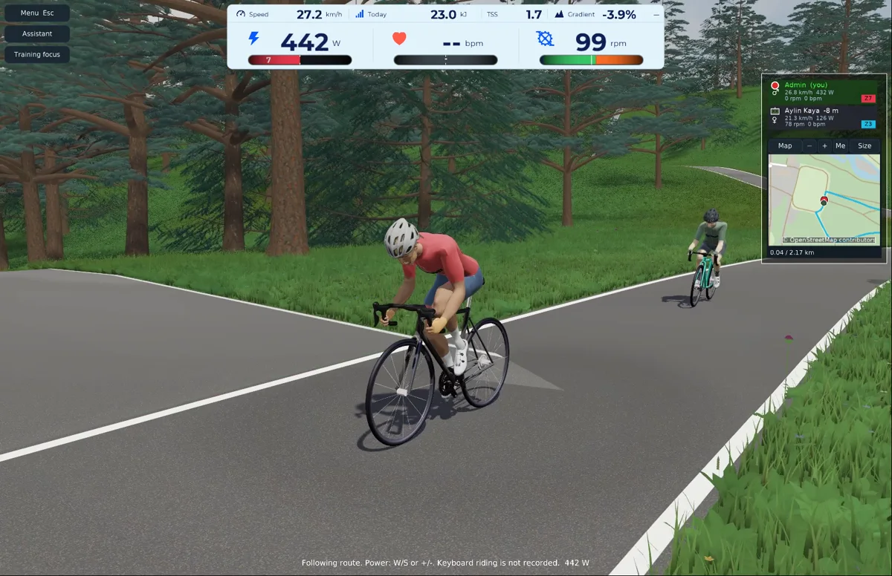
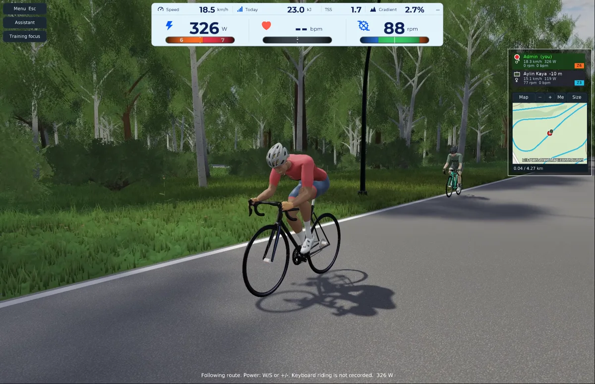
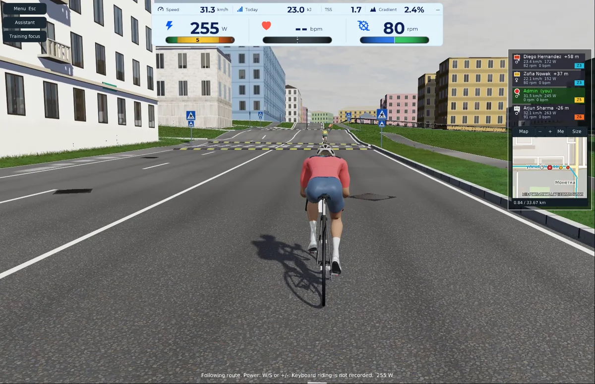
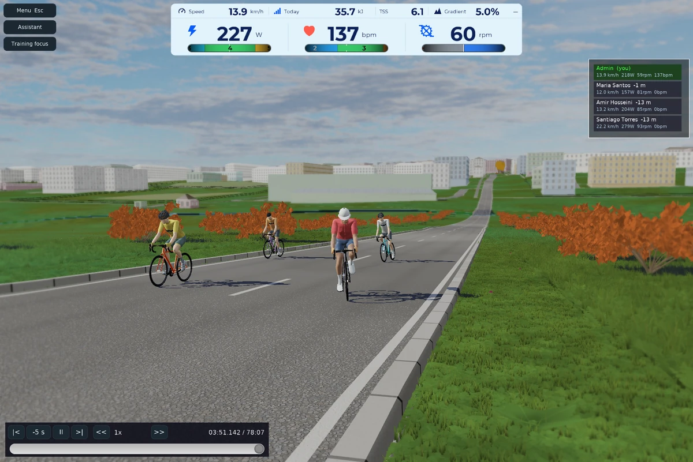
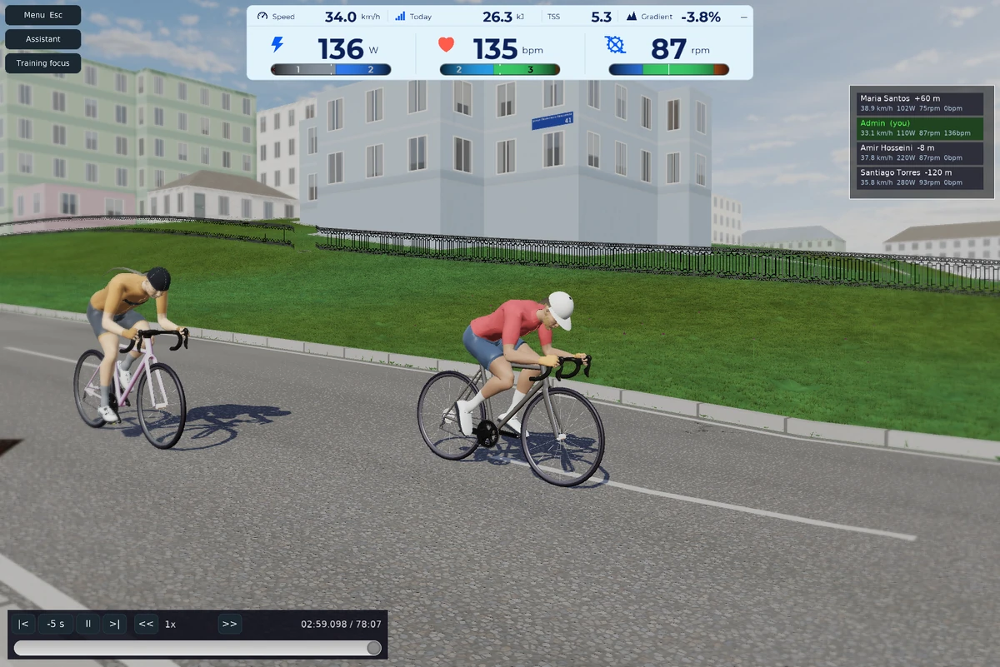
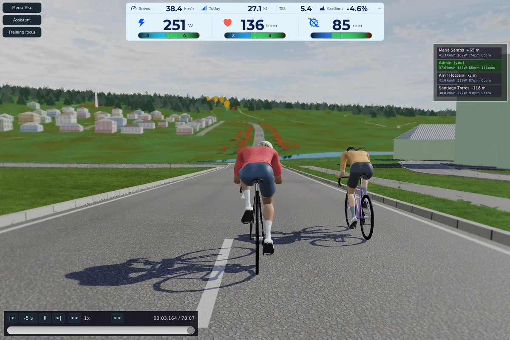
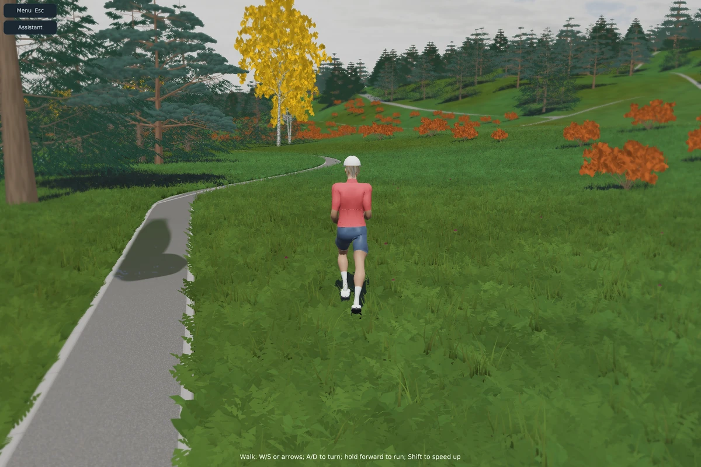
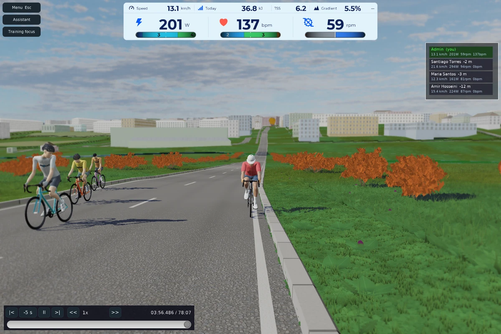
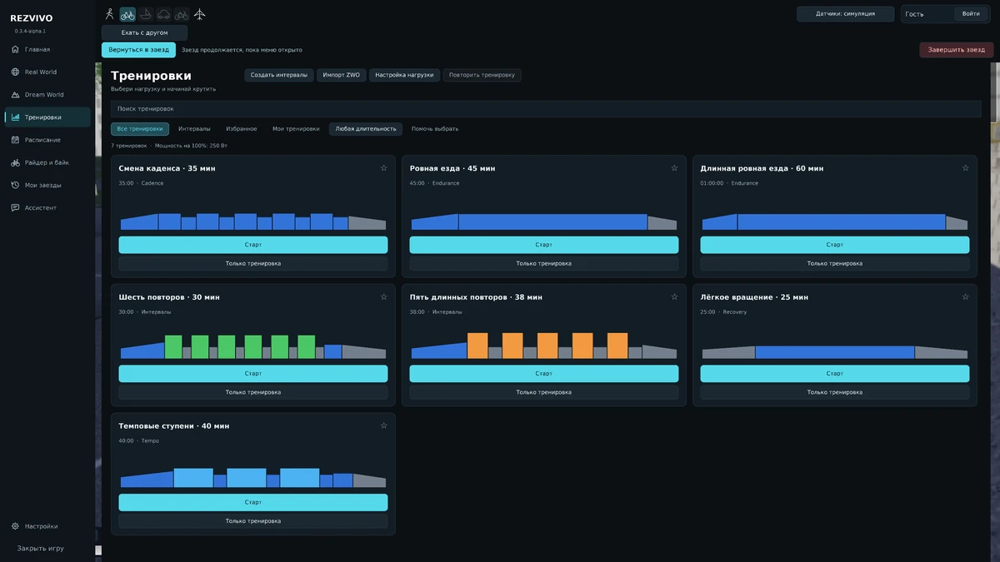
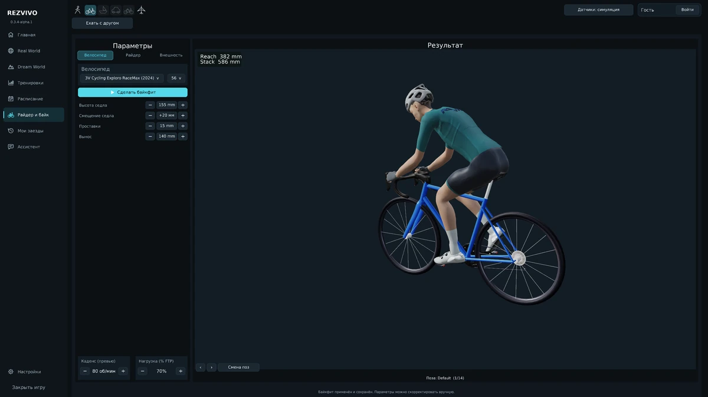

# REZVIVO


**Train, or simply explore the world in 3D.**

REZVIVO is an open-source app for indoor cycling and exploring OpenStreetMap in
3D. Train on your smart trainer, or choose a place on the map and walk, cycle or
fly using your keyboard. You can explore without a trainer or a prepared route.

Terrain, roads, buildings, water and vegetation are generated from OSM and
elevation data, with map tiles loaded as you move. Handcrafted Dream Worlds and
interval workouts offer more ways to ride.

[Website](https://rezvivo.com) · [Features](#features) · [Watch videos](https://rezvivo.com/#videos) · [Download for Windows](https://rezvivo.com/download) ·
[Report an issue on the website](https://rezvivo.com/feedback) or
[GitHub Issues](https://github.com/thpg/rezvivo/issues) · [License](LICENSE)

## Features

Train on a smart trainer or explore the world in 3D. This guide covers the current project, including map-making tools. REZVIVO is in alpha; platform-specific and experimental features are identified below.

Read the guide below or [browse all features on the website](https://rezvivo.com/#features).

<details>
<summary>Explore real and imagined worlds</summary>

1. **Free exploration.** Choose a point on the map and cycle, walk, run or fly freely. You do
    not need a prepared route, a trainer or an account to explore. Switch between travel modes
    within the scene.

2. **The real world in 3D.** Terrain, roads, buildings, bridges, tunnels, water and vegetation
    are generated from OpenStreetMap and elevation data. Nearby areas load as you move. A vector
    map, globe, place search, start-point selection and an in-ride mini-map help you find your
    way.

3. **Routes.** Import FIT and GPX files, create routes on the map, keep a personal library or
    choose from a server catalogue that checks for updates. Prepare routes in advance and check
    their cached data. REZVIVO remembers your last choice; a fresh installation starts with
    Krylatskoye.

4. **Dream Worlds.** Ride and explore a castle island, a lighthouse island, a forested mountain,
    a futuristic district, a red canyon or Demo-world, an environment showcase. You can also
    create your own Dream Worlds with an AI agent.

</details>

<details>
<summary>Train and track your progress</summary>

5. **Trainers and sensors.** Connect smart trainers and power, cadence, speed and heart-rate
    sensors through Bluetooth LE, or ANT+ on a PC with a compatible adapter. Choose separate
    sources for each metric and trainer control, with automatic discovery and connection.
    Compatibility depends on the device protocol.

6. **Bicycle controls.** Real power drives the bicycle when using a trainer. Without one,
    keyboard controls set effort and braking. Elite STERZO Smart steering and gamepad input
    support direction changes in free exploration and lane changes on routes. Android also has
    on-screen controls.

7. **Virtual shifting.** Shift virtual gears using Zwift Click, Play or Ride controllers,
    on-screen buttons, or Page Up / Page Down. The ride panel shows the current gear or ERG mode.
    Enabled by default, with an option to turn it off in device settings. Requires a compatible
    controllable trainer; the calculated-resistance mode also needs live cadence. Experimental
    support: not every controller, trainer and firmware combination has been tested.

8. **Cycling physics and resistance.** Speed responds to power, mass, gradient and resistance,
    with coasting and braking. A smart trainer reproduces the gradient or holds a workout power
    target. Adjustable gradient sensitivity changes trainer resistance without altering measured
    power in the motion calculation. FIT routes can use a prepared load profile from the
    recording.

9. **Interval workouts.** Choose original built-in workouts or start intervals during an
    ordinary ride. The workout panel shows the profile, target, remaining time and progress.
    Pause, resume, skip an interval, restart or adjust the reference power by ±5 W while
    training.

10. **Automatic workout cues.** Start and resume by pedalling. Workouts pause after 5 seconds
    without pedalling, or 15 seconds in recovery and free-ride sections. Coloured gates appear
    before interval changes, with audio cues and a countdown.

11. **Workout editor.** Create and edit workouts, import and save ZWO files. Combine warm-ups,
    cool-downs, steady efforts, power ramps, repeated intervals and free-ride sections. Set
    durations, power targets, cadence guidance and text prompts.

12. **Workout-only mode.** Run intervals without loading a 3D map. A small vertical window lets
    you train while watching a film, using a browser or working in another application. Its
    always-on-top setting is optional.

13. **Schedule and Intervals.icu.** Sync your training calendar, get a prompt for today's
    workout, retrieve routes and automatically upload completed smart-trainer sessions. Uploads
    run in the background and retry when needed. Simulations are excluded from real workout
    uploads.

14. **Metrics and ride recording.** Track power, heart rate, cadence, speed, gradient, time,
    distance, elevation gain, work and TSS. Configure FTP and training zones. Keep ride history
    and FIT recordings, with saved state for recovery after interruptions. Manual controls and
    simulation are kept separate from real training measurements.

</details>

<details>
<summary>Ride together and make it yours</summary>

15. **Group rides.** Create a room, invite a friend or join with a code and see other
    participants in the same scene. Ready-made real-world routes have shared rooms that eligible
    smart-trainer rides join automatically.

16. **Bot companions.** Ride with cyclists of different strengths from a fixed character
    catalogue, with up to three local bots visible at once. They catch up, overtake, attack,
    tire, follow wheels and take turns at the front. Companions can wait for you; oncoming and
    crossing cyclists, glances and a helping-hand gesture add activity.

17. **Body and appearance.** Adjust a shared parametric body: height, weight, fat and muscle
    balance, leg and arm lengths, pelvis and shoulder widths, waist, thighs and calves. Choose
    skin, hair and equipment colours, preview hairstyles including ponytails, braids and
    dreadlocks, and add facial hair. Wear a helmet, bandana, cycling cap or no headwear.

18. **Clothing.** Choose cycling jerseys and bib shorts, T-shirts, sweatshirts, trousers, jeans,
    jackets, coats and raincoats, with footwear, everyday headwear and colours. Fabric
    materials, seams, folds and animated loose clothing are supported. The in-game wardrobe
    works across travel modes.

19. **Bicycles and bike fitting.** Parametric bicycles include road, mountain and fixed-gear
    options. Choose a model and frame size, then adjust the saddle, stem and spacers, or use
    automatic bike fit for your avatar's measurements. Hand and foot positions follow bicycle
    geometry. Bots also receive individual fitting.

20. **Character animation.** Seated and standing pedalling, sustained high-power attacking
    poses, starts, stops and waiting. Pelvis, back, shoulders, arms and head take part, with
    breathing, effort expressions and small posture and grip changes. Walking, running,
    soft-tissue, hair and clothing motion, drift and stationary bicycle-turn animations are included.

</details>

<details>
<summary>Cameras, simulation and AI</summary>

21. **Cameras and capture.** Use following, side, overview, cinematic and free cameras, with
    overview shots while stopped. Save screenshots in the screenshots folder. Record 30 fps MP4
    video with a virtual clock: slower rendering takes longer to record while preserving evenly
    timed animation in the finished video.

22. **FIT ride simulation.** Explore without sensors by replaying recorded power and cadence.
    Speed up, slow down, pause or rewind. Rewinding restores participant positions and recorded
    camera states. Simulation is also available to local profiles.

23. **In-app AI assistant.** Chat with a separately connected external agent through MCP. It can
    navigate the interface, start rides and workouts, change workout settings and follow live
    sensor and interval data. English and Russian voice input and spoken replies are available;
    speech recognition can run locally.

24. **Map refinement from photos and video.** An agent can match imagery to OSM objects and
    refine buildings, roofs, façades, windows, entrances, archways and decoration, as well as
    roads, pavements, vegetation and street objects. Observations persist as tile knowledge for
    later generation. This prepares specific areas; it does not automatically reconstruct the
    entire map on every ride.

</details>

<details>
<summary>Scenery, graphics and sound</summary>

25. **Detailed environments.** Procedural asphalt, concrete, dirt, grass and rock materials,
    with tree, shrub and grass species from different regions. Architectural components add
    variety to buildings, alongside streetlights, fences, steps, signs, water and puddles.

26. **Graphics and performance settings.** Full and Universal renderers, presets, FPS limits,
    anti-aliasing, shadow quality and distance, and vegetation, hair and material detail. Auto
    uses trial rendering and available GPU information to suggest settings; a live preview shows
    FPS. Optional RTX shadows, RTX Screen and reflections require compatible hardware. The world
    image cache is off by default: it may improve speed but can introduce artifacts.

27. **Sound.** Environmental ambience, wind, bicycle and road-impact sounds, workout cues and
    interface clicks, with separate volume controls for each group.

28. **Caching and connectivity.** Compressed binary tile caches, reuse of downloaded source data
    and photos, advance route preparation, cache-size reporting and clearing. Loading shows
    actual work stages and server request status. Prepared data lets you revisit places without
    downloading and generating everything again. Vegetation preparation speed and adaptation to
    frame rate are configurable.

</details>

<details>
<summary>Platforms, tools and open source</summary>

29. **Profiles, platforms and maintenance.** Use a local profile without an account, save
    preferences and personal settings, and choose a UI language. Menus adapt to screen size.
    Development is on PC (Windows x86-64), and an Android build has been successfully tested.
    Castle Game Engine supports Windows, Linux, macOS, FreeBSD, Android, iOS, web browsers
    (WebAssembly/WebGL), Raspberry Pi and Pine64 (Linux on ARM), and Nintendo Switch. For
    REZVIVO, the other platforms are possible in theory and still require porting and
    validation. Nintendo Switch also requires approved Nintendo developer access and the
    engine's separate console integration. Update checks, installer downloads, diagnostic crash
    reports and feedback tools are included. See [CGE platform
    support](https://castle-engine.io/features).

30. **Tools for creators and developers.** OSM3D Studio and tree, avatar, anatomy and bicycle
    editors support scene preparation. Compare source photos with matching 3D views, build and
    rebuild tiles, automate through MCP and inspect CPU/GPU timings and render statistics.
    Development experiments include mesh shaders for part of the conifer rendering; they are not
    the required default renderer.

31. **Open source.** REZVIVO is published on GitHub under GPL-3.0-or-later. Explore the code,
    build and modify the application, contribute improvements or help test it.

</details>

Built with Free Pascal and Castle Game Engine, REZVIVO is in **alpha**.
Development is on **PC (Windows x86-64)**, and an **Android build has been
successfully tested**. The other CGE platforms listed above remain theoretical
porting targets for REZVIVO and still need adaptation and validation. Graphics
performance and device compatibility are still being refined.
For the ready-to-use application, visit the [download page](https://rezvivo.com/download).

## Looking for a Zwift alternative?

REZVIVO combines indoor cycling workouts with free exploration of OpenStreetMap
in 3D. It may suit you if you want to choose a starting point, follow a route or
explore on foot, by bike or in free flight. It is an **open-source alpha**;
graphics, device compatibility and features are still being refined.

These apps share parts of the indoor cycling space, with different approaches:

| App | What its official site describes |
| --- | --- |
| [Zwift](https://www.zwift.com/eu/about/app) | Virtual worlds, structured workouts, social rides and racing. |
| [MyWhoosh](https://www.mywhoosh.com/) | Virtual cycling routes, training plans, group rides and racing events. |
| [TrainingPeaks Virtual](https://www.trainingpeaks.com/virtual/) | Cycling within the TrainingPeaks ecosystem, workout sync, group rides and GPXplore for imported real-world routes. |
| [ROUVY](https://rouvy.com/) | Cycling on filmed real-world routes, training and group rides. |
| [TrainerRoad](https://www.trainerroad.com/) | Personalized cycling plans and workouts that adapt to training history and progress. |

REZVIVO's focus is a navigable 3D world generated from map and elevation data,
alongside smart-trainer intervals and Dream Worlds. Compare the features and
hardware support you need; an alternative is not a promise of feature parity.
The links above are official sources, checked on **2026-10-13**.

**Will my equipment work?** Support in another app does not guarantee support in
REZVIVO. Compatibility depends on the device, protocol, firmware and platform.
Check the [current download information](https://rezvivo.com/download) and try
your setup before relying on it for a workout. You can also explore with your
keyboard, without an account or a smart trainer.

**Are the apps connected?** REZVIVO is an independent project, not affiliated
with or endorsed by the products listed above. Names belong to their respective
owners. This comparison does not imply shared accounts, workout synchronization
or route transfers between apps.

[Compare indoor cycling apps on the website](https://rezvivo.com/#indoor-cycling-alternatives).
Related topics: [zwift-alternative](https://github.com/topics/zwift-alternative),
[indoor-cycling](https://github.com/topics/indoor-cycling),
[openstreetmap](https://github.com/topics/openstreetmap).

## Videos

Recordings from REZVIVO, with the in-game interface. Click a preview to play the
video in your browser, or download the MP4 from the GitHub release.

<table>
  <tr>
    <td align="center" width="50%">
      <a href="https://rezvivo.com/static/videos/2026-10-15/pine-forest.mp4"></a><br>
      Riding through a pine forest · 1:01<br>
      <a href="https://github.com/thpg/rezvivo/releases/download/v0.4.1-alpha.1/rezvivo-pine-forest.mp4">Download on GitHub</a>
    </td>
    <td align="center" width="50%">
      <a href="https://rezvivo.com/static/videos/2026-10-15/birch-road.mp4"></a><br>
      A road among birch trees · 0:50<br>
      <a href="https://github.com/thpg/rezvivo/releases/download/v0.4.1-alpha.1/rezvivo-birch-road.mp4">Download on GitHub</a>
    </td>
  </tr>
  <tr>
    <td align="center" colspan="2">
      <a href="https://rezvivo.com/static/videos/2026-10-15/city-ride.mp4"></a><br>
      City riding with companions · 1:45<br>
      <a href="https://github.com/thpg/rezvivo/releases/download/v0.4.1-alpha.1/rezvivo-city-ride.mp4">Download on GitHub</a>
    </td>
  </tr>
</table>

## Screenshots

Click any preview to view the original, full-size screenshot.

<table>
  <tr>
    <td align="center" colspan="2">
      <a href="https://media.githubusercontent.com/media/thpg/rezvivo/main/docs/screenshots/2026-10-11/group-climb.png"></a><br>
      Climbing with bots
    </td>
  </tr>
  <tr>
    <td align="center" width="50%">
      <a href="https://media.githubusercontent.com/media/thpg/rezvivo/main/docs/screenshots/2026-10-11/city-pair.png"></a><br>
      Riding together in the city
    </td>
    <td align="center" width="50%">
      <a href="https://media.githubusercontent.com/media/thpg/rezvivo/main/docs/screenshots/2026-10-11/river-descent.png"></a><br>
      Descending toward the river
    </td>
  </tr>
  <tr>
    <td align="center" width="50%">
      <a href="https://media.githubusercontent.com/media/thpg/rezvivo/main/docs/screenshots/2026-10-11/forest-walk.png"></a><br>
      Explore the forest on foot
    </td>
    <td align="center" width="50%">
      <a href="https://media.githubusercontent.com/media/thpg/rezvivo/main/docs/screenshots/2026-10-11/overtaking.png"></a><br>
      Riders overtaking
    </td>
  </tr>
  <tr>
    <td align="center" width="50%">
      <a href="https://media.githubusercontent.com/media/thpg/rezvivo/main/docs/screenshots/2026-10-11/workout-library.png"></a><br>
      Interval workout library
    </td>
    <td align="center" width="50%">
      <a href="https://media.githubusercontent.com/media/thpg/rezvivo/main/docs/screenshots/2026-10-11/bike-fit.png"></a><br>
      Rider and bicycle fitting
    </td>
  </tr>
</table>

## Build from source

Requirements: **Free Pascal 3.2.2 for Windows x86-64** (including `windres.exe`
and `cpp.exe`), PowerShell 5.1 or later, and Git with [Git LFS](https://git-lfs.com/).
A suitable FPC installation is included with Lazarus.

After the one-time source and engine setup below, compile the Pascal application
from the repository root:

```powershell
powershell -File rezvivo-osm-bckl/build-performance-release.ps1 `
  -EngineRoot "$PWD/../rezvivo-dependencies/cge" `
  -Compiler "C:/tools/fpc/3.2.2/bin/x86_64-win64/fpc.exe"
```

Replace the compiler path with your installation. The script invokes `fpc.exe`
to compile the game and CGE, and `windres.exe` to embed the version and icon.

<details>
<summary>First-time source and CGE setup</summary>

Run these commands once in PowerShell. Use a new directory for CGE:

```powershell
git lfs install
git clone https://github.com/thpg/rezvivo.git
cd rezvivo
git lfs pull

$engine = "$PWD/../rezvivo-dependencies/cge"
$lock = Get-Content dependencies/engine.json -Raw | ConvertFrom-Json
git init $engine
git -C $engine config core.autocrlf false
git -C $engine remote add origin $lock.repository
git -C $engine sparse-checkout init --cone
git -C $engine sparse-checkout set src doc/licenses tools packages
git -C $engine fetch --depth=1 --filter=blob:none origin $lock.commit
git -C $engine checkout --detach FETCH_HEAD
```

This checks out the pinned revision of the [`rezvivo` branch in our CGE fork](https://github.com/thpg/castle-engine/tree/rezvivo),
as recorded in [the dependency lock](dependencies/engine.json). Our engine changes
are already committed; there is no separate patch to apply. The engine stays in the sibling
`rezvivo-dependencies/cge` directory, outside this repository.

</details>

To edit `.castle-user-interface` designs, use Lazarus and the CGE editor from
this pinned engine. Open `rezvivo-osm-bckl/CastleEngineManifest.xml` and choose
**Project → Restart Editor (With Custom Components)**. The manifest declares
`GameMenuTheme`, `GameEnemy` and `Osm3dImpostorCache` as `editor_units`, including
the `TMenuButton` and `TOsmImpostorViewport` classes used by the UI designs.
Configure the Lazarus path in the editor's
preferences if it cannot find `lazbuild`.

The executable is written to `rezvivo-osm-bckl/third_person_navigation.exe`.
Keep `data` beside it. Runtime DLLs are supplied separately;
[dependencies/runtime.json](dependencies/runtime.json) lists the expected files,
observed versions, hashes and upstream sources. Compilation does not require
those DLLs, but running and packaging the client does.

Offline voice input uses the optional Vosk runtime and small English/Russian models.
Restore them with `powershell -File rezvivo-osm-bckl/tools/prepare-speech-assets.ps1`.
The Windows installer includes them; Git contains the upstream URLs, checksums
and license notices in [data/speech/assets.json](rezvivo-osm-bckl/data/speech/assets.json).

Offline 30 fps MP4 recording uses a separate FFmpeg process. Restore the pinned
desktop encoder with `powershell -File rezvivo-osm-bckl/tools/prepare-video-encoder.ps1`.
The Windows installer includes it; source and license references are in
[tools/video/NOTICE.txt](rezvivo-osm-bckl/tools/video/NOTICE.txt).

The optional RTX backend has its source in [Osm3d/rtx](Osm3d/rtx). To build it,
install the Visual C++ x64 build tools and a Vulkan SDK shader compiler, then add
`-BuildRtx -Glslang "C:/VulkanSDK/<version>/Bin/glslangValidator.exe"` to the build
command above. Its script fetches the pinned Khronos headers and copies the DLL
and compiled shaders beside the game. The regular Pascal build uses raster
rendering when the RTX backend is unavailable.

Review the [distribution notes](PUBLICATION.md) before redistributing a binary package.

## Repository layout

| Directory | Contents |
| --- | --- |
| `rezvivo-osm-bckl/code` | Game, menus, rides, workouts, devices and client services |
| `rezvivo-osm-bckl/data` | Runtime assets selected by the installer |
| `Bikeparametric` | Shared bicycle, rider, pose and animation code |
| `Osm3d` | World generation, rendering, terrain, roads, vegetation and tile caching |
| `tree-editor/core`, `tree-editor/render` | Vegetation modules used by the game |
| `Mcp` | Diagnostic interface modules |
| `dependencies` | Pinned CGE fork, dependency versions and asset provenance |
| `tools`, `.github` | Source checks and continuous integration |

This repository contains the game and the shared modules needed to build it.
Standalone editor applications and server deployment code are separate.
The seven included workouts are original REZVIVO workouts.

## Contributing

Report bugs and suggest improvements through the
[website feedback form](https://rezvivo.com/feedback) or
[GitHub Issues](https://github.com/thpg/rezvivo/issues).
For rendering issues, include the game version, GPU, graphics settings and the
route or Dream World involved. Review attached logs for personal information.

Automated publication checks validate the file allowlist and runtime asset hashes,
inspect model metadata and run Gitleaks. Update `dependencies/files.json` when adding
reviewed source files and `dependencies/assets.json` when changing packaged assets.
CI also checks Git history for secrets. No automatic deployment jobs are included.

## License and third-party content

REZVIVO-owned source code and original assets are licensed under
**GPL-3.0-or-later**: GNU General Public License version 3, or, at your option,
any later version. See [LICENSE](LICENSE).

Third-party components retain their own licenses and attribution.
See [THIRD_PARTY_NOTICES.md](THIRD_PARTY_NOTICES.md),
[the asset inventory](dependencies/assets.json) and
[the open provenance and binary-distribution review](PUBLICATION.md).
An entry marked `REVIEW` is not a declaration that its rights have been cleared.
Downloaded OpenStreetMap data remains subject to its own attribution and license.
